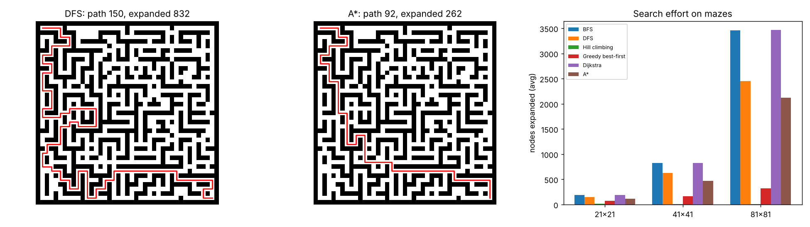

# Maze and Route Solver using AI Search Techniques

**Team:** [Optimal Five] – [ADITYA], [Vasu Gangal], [Ronit Aggarwal], [Himanshu Shah], [Akshat Goel]
**Course:** ITITC503 – Artificial Intelligence

Compares BFS, DFS, hill climbing, greedy best-first, Dijkstra and A* (plus weighted A* and
8-direction heuristics) on random mazes and weighted city-route grids.

**Live demo:** [GitHub Pages link]



## Key findings
- A* found the optimal route in 50/50 runs and explored about 40% fewer nodes than BFS on mazes.
- Heuristic quality matters: Octile distance cut A* search by 57% vs Dijkstra with 8-direction moves.
- Weighted A* (w=1.5) explored about 74% fewer nodes on mazes for a 3.5% longer route.
- DFS routes were 5 to 7 times optimal; hill climbing failed on every maze (local optima).

## Run
```
pip install matplotlib
python maze_route_solver.py          # first experiments + search_comparison.png
python deadline2_experiments.py      # statistics, weighted A*, 8-direction, figures
```
Open `index.html` in a browser for the interactive race demo.

## Files
| File | Purpose |
|---|---|
| `maze_route_solver.py` | generators, six algorithms, first experiments |
| `deadline2_experiments.py` | 50-run statistics, weighted A*, 8-direction heuristics, graphs |
| `index.html` | interactive demo (BFS vs DFS vs Greedy vs A*) |
| `results_deadline2.txt`, `maze_results.txt` | saved outputs |
| `fig_*.png`, `search_comparison.png` | result figures |
| `Maze_Route_Solver_Final_Report_Deadline2.docx` | final report |

## Syllabus mapping
Unit 1: state-space search, problem characteristics. Unit 2: DFS, hill climbing, best-first, A*.
